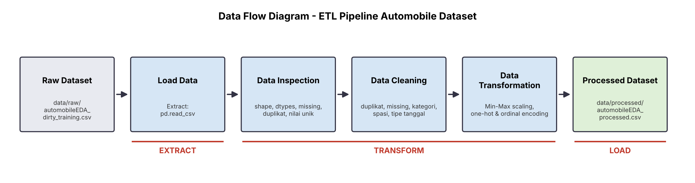

# Data Pipeline Assignment - Automobile Dataset

Pipeline ETL berbasis Python/Pandas yang membaca dataset mobil yang "kotor", memeriksa, membersihkan, mentransformasi, lalu menyimpannya sebagai dataset siap analisis.

## 1. Deskripsi dan Sumber Dataset

- **Isi:** data 205 mobil dengan 30 kolom: spesifikasi teknis (ukuran mesin, tenaga kuda, bobot, bore, stroke, dll), kategori (merek, tipe bodi, penggerak roda, sistem bahan bakar), konsumsi bahan bakar, harga (`price`), dan kolom `transaction_date`.
- **Sumber:** dataset *Automobile (Imports-85)* dari UCI Machine Learning Repository dalam versi EDA yang disediakan untuk assignment ini (`automobileEDA_dirty_training.csv`). Versi ini sengaja dikotori (tanggal campuran, kategori tidak konsisten, duplikat, nilai kosong).

## 2. Struktur Folder

```
data-pipeline-assignment/
├── data/
│   ├── raw/automobileEDA_dirty_training.csv        # data mentah (tidak pernah diubah)
│   └── processed/automobileEDA_processed.csv       # hasil pipeline
├── src/pipeline.py
├── documentation/data-flow-diagram.png
├── README.md
└── requirements.txt
```

## 3. Kondisi Awal Dataset

| Aspek | Temuan |
|---|---|
| Ukuran awal | **205 baris x 30 kolom** |
| Missing values | **17 sel kosong** di 7 kolom: `transaction_date` (2), `make` (2), `num-of-doors` (2), `stroke` (4), `horsepower` (3), `price` (3), `horsepower-binned` (1) |
| Duplicate records | **4 baris** (baris 202-205 adalah salinan persis baris 6, 26, 61, 101) |
| Tipe data belum sesuai | `transaction_date` bertipe string, bukan datetime |
| Kategori tidak konsisten | `make`: `ALFA-ROMERO`, `Audi`, `BMW`, serta spasi di belakang (`dodge  `, `mercury  `, `porsche  `); `body-style`: `SEDAN`, `Sedan`; `drive-wheels`: `AWD`, `RWD`; `fuel-system`: `MPFI`, `Mpfi` |
| Masalah lain | (a) `transaction_date` memakai 4 format berbeda (`2025-01-01`, `02/01/2025`, `01-03-2025`, `04-Jan-2025`); (b) salah ketik merek `peugot`; (c) `length` dan `width` sudah dalam skala 0-1 (bawaan dataset EDA), berbeda dari kolom ukuran lain; (d) `normalized-losses` memiliki 43 baris bernilai 122, tanda sudah diisi nilai rata-rata di sumber aslinya |

## 4. Data Cleaning

| Masalah | Kolom | Metode | Alasan |
|---|---|---|---|
| Spasi & huruf besar/kecil | `make`, `body-style`, `drive-wheels`, `fuel-system`, dan kategori lain | `strip()` + `lower()` | Agar `Sedan`, `SEDAN`, `sedan` dihitung sebagai satu kategori |
| Salah ketik | `make` | `peugot` -> `peugeot` | Penulisan merek yang benar |
| Tanggal campuran | `transaction_date` | Parsing per format menjadi `datetime` | Tipe datetime memungkinkan pengurutan dan analisis waktu. Format dengan `/` dibaca `dd/mm/yyyy`, format dengan `-` dibaca `mm-dd-yyyy`. Aturan ini diverifikasi karena tanggal di data berurutan harian dari 1 Jan 2025 |
| Duplikat | semua kolom | `drop_duplicates()` setelah penyeragaman | Duplikat menggandakan bobot satu mobil. Dilakukan setelah penyeragaman agar duplikat tersembunyi ikut terdeteksi (4 terhapus) |
| Kosong, kategorikal | `num-of-doors` (2) | Diisi modus per `body-style` (sedan -> `four`) | Jumlah pintu sangat ditentukan tipe bodi |
| Kosong, numerik | `price` (3), `stroke` (4), `horsepower` (3) | Diisi **median** (10.270, 3.29, dan 95) | Median tahan terhadap outlier (harga dan tenaga kuda condong ke kanan oleh mobil mewah), sehingga lebih representatif daripada rata-rata |
| Kosong, turunan | `horsepower-binned` (1) | Dihitung ulang dari `horsepower` (Low <=101, Medium 102-155, High >=156) | Kolom ini turunan dari `horsepower`, sehingga lebih akurat dihitung ulang. Baris itu (`jaguar`, 262 hp) menjadi `High` |
| Kosong, tidak dapat diketahui | `make` (1 setelah dedup) | Diisi `unknown`, baris dipertahankan | Spesifikasi lain lengkap, merek tidak bisa ditebak |
| Kosong, tidak dapat diketahui | `transaction_date` (2) | **Dipertahankan** sebagai kosong | Tanggal tidak bisa ditebak dan tidak dipakai di kolom lain |

**Hasil cleaning**

| | Sebelum | Sesudah |
|---|---|---|
| Jumlah baris | 205 | **201** (4 duplikat dihapus) |
| Total missing values | 17 | **2** (hanya `transaction_date`, sengaja dipertahankan) |
| Duplicate records | 4 | 0 |

Kolom yang berubah: `transaction_date`, `make`, `num-of-doors`, `body-style`, `drive-wheels`, `fuel-system`, `stroke`, `horsepower`, `price`, `horsepower-binned`.

Contoh pembersihan kategori: `ALFA-ROMERO` -> `alfa-romero`, `SEDAN` -> `sedan`, `RWD` -> `rwd`, `Mpfi` -> `mpfi`, `dodge␣␣` -> `dodge`.

## 5. Data Transformation

Transformasi dijalankan lewat **preprocessing pipeline scikit-learn** (`Pipeline` + `ColumnTransformer`, dibuat oleh `build_preprocessor()`) yang diterapkan pada data yang sudah bersih.

| Kolom asal | Metode | Kolom hasil | Alasan |
|---|---|---|---|
| 14 kolom numerik kontinu (lihat tabel statistik di bawah) | **Min-Max Scaling** dengan `MinMaxScaler(feature_range=(0, 1), clip=True)`, rumus `(x - min)/(max - min)` | `<kolom>_scaled` (14 kolom) | Rentang asli sangat berbeda (`curb-weight` ribuan, `bore` sekitar 3). Skala 0-1 membuat kolom sebanding untuk model berbasis jarak atau gradien |
| `horsepower-binned` | **Ordinal encoding** (Low=0, Medium=1, High=2) | `horsepower-binned_encoded` | Kategori punya urutan alami |
| `aspiration`, `body-style`, `drive-wheels` | **One-hot encoding** (0/1) | `aspiration_*`, `body-style_*`, `drive-wheels_*` (11 kolom) | Kategori tanpa urutan, jumlah nilai unik sedikit |

Kolom asli tetap disimpan agar nilai sebelum dan sesudah bisa dibandingkan. Dataset akhir: **201 baris x 56 kolom** (30 kolom asli + 14 `_scaled` + 1 ordinal + 11 one-hot).

**Pengaturan Min-Max Scaling (best practice)**

- **Hanya kolom numerik kontinu yang di-scale.** Tidak di-scale: `symboling` (rating risiko ordinal -2 sampai 3), `length` dan `width` (sudah berskala 0-1 dari sumber dataset), serta `diesel` dan `gas` (biner 0/1). Kolom hasil one-hot dan ordinal juga tidak di-scale.
- **`price` adalah kolom target dan tetap di-scale di tugas ini** (`price_scaled`) sebagai bahan latihan transformasi. Kolom `price` asli tetap disimpan. Untuk modeling, target umumnya tidak di-scale (atau, kalau di-scale, prediksinya dikembalikan ke skala asli dengan `inverse_transform`).
- **Scaling dilakukan setelah cleaning.** Tidak ada NaN pada kolom yang di-scale (pipeline akan berhenti dengan error bila masih ada), dan nilai pengisi median dihitung sebelum scaling.
- **`clip=True`** menjaga data baru yang nilainya melewati rentang data latih tetap berada di 0-1, dan `handle_unknown="ignore"` pada one-hot mencegah error bila muncul kategori baru. Karena itu objek `build_preprocessor()` bisa dipakai ulang pada data baru.
- **Tidak ada train/test split** karena tugas ini hanya sampai cleaning dan transformation, sehingga scaler di-fit pada seluruh data bersih.
- **Catatan outlier:** Min-Max sensitif terhadap outlier. Contohnya `compression-ratio` bernilai maksimum 23 (mobil diesel), sehingga 180 dari 181 mobil bensin terkumpul di rentang 0-0,2. Nilai ini valid, jadi tidak dibuang.
**Statistik sebelum dan sesudah Min-Max Scaling**

| Kolom | Min sebelum | Max sebelum | Min sesudah | Max sesudah |
|---|---|---|---|---|
| `normalized-losses` | 65 | 256 | 0 | 1 |
| `wheel-base` | 86,6 | 120,9 | 0 | 1 |
| `height` | 47,8 | 59,8 | 0 | 1 |
| `curb-weight` | 1488 | 4066 | 0 | 1 |
| `engine-size` | 61 | 326 | 0 | 1 |
| `bore` | 2,54 | 3,94 | 0 | 1 |
| `stroke` | 2,07 | 4,17 | 0 | 1 |
| `compression-ratio` | 7 | 23 | 0 | 1 |
| `horsepower` | 48 | 262 | 0 | 1 |
| `peak-rpm` | 4150 | 6600 | 0 | 1 |
| `city-mpg` | 13 | 49 | 0 | 1 |
| `highway-mpg` | 16 | 54 | 0 | 1 |
| `city-L/100km` | 4,80 | 18,08 | 0 | 1 |
| `price` | 5118 | 45400 | 0 | 1 |

**Contoh sebelum dan sesudah (per baris)**

| price | price_scaled | horsepower | horsepower_scaled | curb-weight | curb-weight_scaled | horsepower-binned | _encoded |
|---|---|---|---|---|---|---|---|
| 13495 | 0.2080 | 111 | 0.2944 | 2548 | 0.4112 | Medium | 1 |
| 16500 | 0.2826 | 154 | 0.4953 | 2823 | 0.5178 | Medium | 1 |
| 13950 | 0.2193 | 102 | 0.2523 | 2337 | 0.3293 | Medium | 1 |

Contoh one-hot untuk `body-style`:

| body-style (asli) | body-style_convertible | body-style_hatchback | body-style_sedan |
|---|---|---|---|
| convertible | 1 | 0 | 0 |
| hatchback | 0 | 1 | 0 |
| sedan | 0 | 0 | 1 |

## 6. Alur ETL



| Tahap | Proses | Fungsi di `pipeline.py` |
|---|---|---|
| **Extract** | Membaca CSV dari `data/raw/` | `load_data()` |
| **Transform** | Inspeksi, cleaning, transformasi (preprocessing pipeline sklearn) | `inspect_data()`, `clean_data()`, `transform_data()` yang memakai `build_preprocessor()` |
| **Load** | Menyimpan ke `data/processed/` | `save_data()` |

Seluruh fungsi digabung dalam `run_pipeline()` dan berjalan sekali eksekusi. Data mentah hanya dibaca, tidak pernah ditulis ulang.

## 7. Instalasi dan Menjalankan

```bash
pip install -r requirements.txt
python src/pipeline.py
```

Jalankan dari folder root project. Terminal akan menampilkan hasil inspeksi, ringkasan cleaning (jumlah baris, missing values, duplikat, kolom berubah), dan perbandingan transformasi.

## 8. Lokasi Hasil

Dataset hasil olahan: `data/processed/automobileEDA_processed.csv` (dibuat otomatis oleh pipeline).
